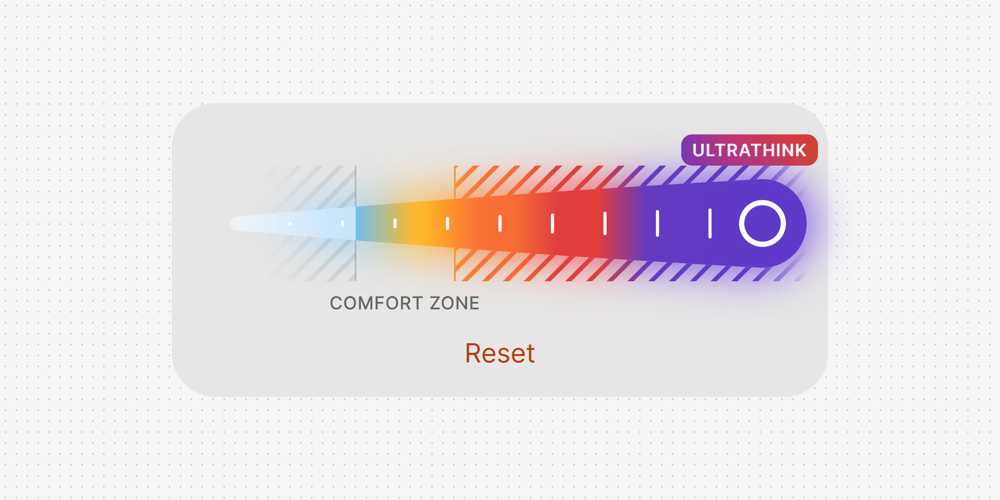
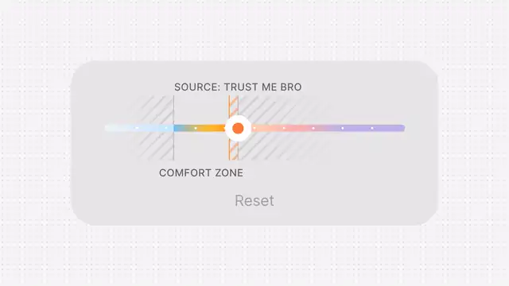

<p align="center">
  
</p>

<p align="center">
  <a href="https://likemiens.com/ui/effort-picker"><b>Live demo</b></a> ·
  <a href="media/demo.mp4"><b>Video</b></a> ·
  <a href="#quick-start"><b>Quick start</b></a>
</p>

<p align="center">
  Made by Likemiens ·
  <a href="https://x.com/a_varantsov">X</a> ·
  <a href="https://t.me/Likemiens">Telegram</a> ·
  <a href="https://github.com/Likemiens">GitHub</a>
</p>

**Effort Picker** sets how hard something should try, from 0 to 10: an AI agent's thinking, a workout, anything with a usual range. A thin line swells into a drop under the finger, a tooltip stands over it outside the usual range, and at the maximum the bar comes alive.

It is a React component in two files. It only draws: your app keeps the suggestion, the range and the saving, and the picker tells you what the user chose.

<p align="center">
  
</p>

## Features

- **A line that swells into a drop.** Thin at rest. Under the finger it grows into one shape, with a thin tip at the easy end and a round head at the hard one. On the last level the thumb sits in the very middle of the head.
- **A tooltip that knows your range.** A caption marks the suggested level. Move out of the usual range and a solid plate takes its place, over the thumb, standing on a hatched block that runs from the range to the thumb.
- **Alive at the maximum.** A light runs along the bar and hits the head, which thumps. The bar glows, the stripes march, and the tooltip's colours flow.
- **Stays in the hand.** A press on the thumb takes it with its offset, with no jump, and a press on the line sends it there. Let go and it settles on a whole level. A finger scrolling the page over the line changes nothing.
- **Keyboard and screen readers.** The thumb is a slider: arrow keys, Page Up, Page Down, Home and End. Every word comes from you.
- **Light.** No dependencies besides React. It rests while off-screen and respects "reduce motion".

## Quick start

Install it:

```bash
npm i @likemiens/effort-picker
```

Or copy `effort-picker.tsx` and `effort-picker.css` into your project, side by side, and import from `./effort-picker`.

Then give it its words, the suggestion and the range:

```tsx
import { EffortPicker, type EffortPickerLabels } from "@likemiens/effort-picker"; // brings effort-picker.css with it

const labels: EffortPickerLabels = {
  label: "How hard to think",
  suggested: "Source: trust me bro",
  below: "LGTM, ship it",
  above: "Burning tokens",
  max: "Ultrathink",
  usual: "Comfort zone",
  clear: "Reset",
};

export function AgentEffort({ agent }) {
  return (
    <EffortPicker
      labels={labels}
      suggested={agent.suggestedEffort} // 0…10, fractions allowed
      usualRange={[2.25, 4.14]}
      onChange={(level) => agent.setEffort(level)}
      onClear={() => agent.resetEffort()}
    />
  );
}
```

It keeps the level itself. [example.tsx](example.tsx) is a complete version.

> [!NOTE]
> **Next.js:** `effort-picker.tsx` already starts with `"use client"`. It takes functions, so render it from a client component: put `"use client"` at the top of the file with `AgentEffort`.

## Props

| Prop | Type | Default | What it does |
|---|---|---|---|
| `labels` | `EffortPickerLabels` | required | Every word on it. |
| `suggested` | `number` | required | The suggested level, 0…10, fractions allowed. It starts here, the caption stands over it, and reset comes back to it. |
| `usualRange` | `[number, number]` | required | The usual range, in levels. The tooltip shows outside it. |
| `value` | `number` | — | The level, when the parent decides it. Leave it out and the picker keeps it itself. |
| `pressed` | `boolean` | — | Holds the drop swollen, as under a finger. Leave it out and it follows the pointer and the keys. |

### Labels

All of them are required:

| Label | Where it goes |
|---|---|
| `label` | the slider's name, for screen readers |
| `suggested` | the caption over the line at rest |
| `below`, `above` | the tooltip under and over the usual range |
| `max` | the tooltip at the maximum |
| `usual` | the caption under the usual range |
| `clear` | the button that goes back to the suggestion |

## Callbacks

| Callback | When it is called |
|---|---|
| `onChange(level)` | The user went to a whole level: at each one crossed, and where the thumb is let go. |
| `onPressedChange(pressed)` | The user pressed the thumb or the line, or let go. |
| `onClear()` | The user went back to the suggestion. |

## Styling

Colours come from CSS custom properties, set on `.ep` or on a parent with a more specific selector. These are the defaults:

```css
.effort .ep {
  --ep-surface: #e7e5e6;           /* the sheet */
  --ep-dim: #666465;               /* the captions */
  --ep-hatch: rgb(40 30 35 / 9.5%); /* the grey stripes */
  --ep-edge: rgb(40 30 35 / 20%);  /* the hairlines of the range */
  --ep-below: #1c77cc;             /* the tooltip under the range */
  --ep-above: #dc3639;             /* the tooltip over the range */
  --ep-accent: #b03e18;            /* the reset button */
  --ep-off: #a3a1a2;               /* the reset button with nothing to reset */
}
```

The picker uses your page's font and is at most 420 px wide. The colours of the line itself are fixed: they run from the easy end to the hard one and mean something.

## Keyboard

The thumb is one Tab stop, and reset the next one.

| Key | What it does |
|---|---|
| `←` `→` `↑` `↓` | one level |
| `Page Up` `Page Down` | two levels |
| `Home` `End` | to the ends |

## Files

```
effort-picker.tsx   the component and its types
effort-picker.css   its styles and colours
example.tsx         a complete usage, to start from
AGENTS.md           notes for coding agents
media/              the cover, the preview and the video
```

## Credits

The line, its colours, its hatching and the way its tooltip works follow the effort picker of [Gentler Streak](https://gentler.app), as [Design Spells](https://designspells.com/spells/effort-picker-animations-in-gentler-streak) shows it. The drop, the maximum, the words and the code are this project's own.

## Author

Made by **Likemiens**. Say hi or share what you built: [X](https://x.com/a_varantsov) · [Telegram](https://t.me/Likemiens) · [GitHub](https://github.com/Likemiens)

## License

[MIT](LICENSE) © Likemiens
